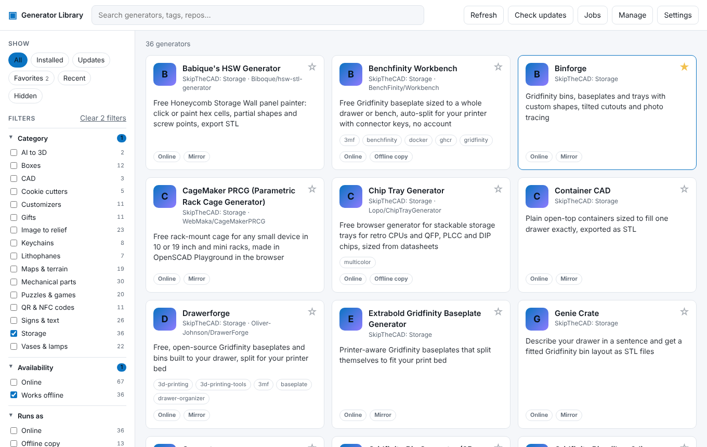
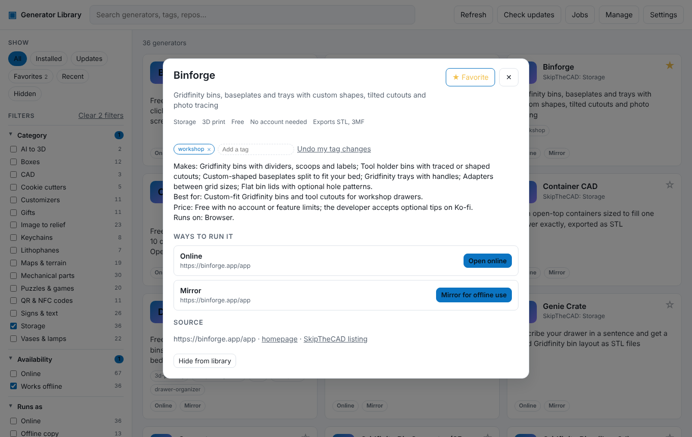

# Generator Library

One place to browse, search, install, launch and update model generators: web apps and standalone executables, pulled straight from GitHub.



- **Browse and search** every generator by name, tag, process (3D print, laser…) and how it runs.
- **Open online**, **install an offline copy** served locally, or **install the desktop app**, from the same card.
- **Update from GitHub**: each install remembers its release tag or commit and can be checked and updated in one click.
- **Bulk updates**: **Updates** checks everything installed and lists what has a newer build, plus mirrored sites. Pick a group (All, Shown now — whatever the filters or a collection show — Favorites, GitHub only, Website downloads, Mirrors), untick any you want to leave, and update them one after another. Mirrors due a resync are ticked; versions you chose under Versions are left alone.
- **Apps without GitHub**: an app that publishes its desktop builds on its own website (Mini Skyline) installs the newest file its download page offers, and a new file there shows as an update.
- **Built from source**: web apps with no download (PrintKit, STLmill, Text to STL…) are built on your computer from their GitHub repository with the library's own private Node.js, so everything they load is there offline. Apps whose build needs more than Node.js (OpenSCAD Playground, the original Vostok Labs site), or that load their libraries from a CDN (BumpMesh), are built every day by [`library-bundles.yml`](.github/workflows/library-bundles.yml) and installed from its pre-releases.
- **Portable**: the portable builds keep the whole library (apps, saved data, Python, Node.js) in a folder beside the app, so it can live on a USB drive. **Settings → Library folder** moves it anywhere.
- **Keep several versions**: updates keep the previous versions, and **Versions** lets you install any release and choose which one launches.
- **Split up multi-generator apps**: a monorepo lists each generator on its own card.
- **WebMirror built in**: generators with no downloadable build are captured for offline use with [WebMirror](https://github.com/DrFlGd/WebMirror). The library installs its own private Python and WebMirror the first time, so there is nothing to set up. WebMirror follows its main branch and is refreshed when it is a day old, and a mirrored site shows **Resync** once its copy is older than the days set in Settings (30 by default).
- **Jobs panel**: every install, mirror and download shows its progress, log and any error.
- **Manage projects**: add any GitHub repository or website link, hide what you do not use, and remove or restore projects, all from the app.
- **Filter panel**: tick any mix of category, availability (online, works offline, ready offline), how it runs, price, sign-up, process, source (open source, MakerWorld, SkipTheCAD), export format and tags. Each number shows how many results that choice would give.
- **Favorites and your own tags**: star a generator on its card or in its detail view, then pick **Show → Favorites**. Add or remove tags in the detail view; your changes stay on your computer and survive catalog updates, and **Undo my tag changes** goes back to the catalog's tags.
- **Edit a generator**: **Edit** in its detail view changes its name, summary, website, GitHub repository and links, turns its web mirror on or off, and adds, changes or removes ways to install it (repository files, a build from source, a release download, a desktop app). Only what differs from the catalog is kept, on your computer, so later catalog changes still arrive; **Go back to the catalog's version** undoes it.
- **Your own collections**: **Collections → + New** in the sidebar makes a named list, and the Collections row in a generator's page adds it to or takes it out of any of them. Click a collection to show only what is in it; rename or delete it from the same row.
- **The SkipTheCAD directory**: about 650 generators from [SkipTheCAD](https://skipthecad.com/) are listed by category. MakerWorld models open on MakerWorld; generators with a GitHub repository install from its releases or build from its source; free tools that need no account can be mirrored. [`scripts/import-skipthecad.mjs`](scripts/import-skipthecad.mjs) does the import, and a weekly workflow ([`skipthecad.yml`](.github/workflows/skipthecad.yml)) runs it again and opens a pull request when the directory changes.
- **Mark mirrors that work offline**: many sites still need their own server after mirroring. On a generator's Mirror row, mark the copy **Works offline** or **Needs the internet**; the card shows Mirror ✓ or ✗, the **Mirror checked** filter finds either (or the ones not checked yet), and a mirror marked as needing the internet no longer counts under Works offline or Ready offline. The marks stay on your computer.
- **Your work stays put**: each app is served on the same local address every launch, so what it saves in the browser (settings, layouts) is there next time.



## Install

Download the Windows installer or portable exe from the [releases page](https://github.com/DrFlGd/Generator-Library/releases) (or the latest **Desktop builds** workflow run under Actions). The binaries are unsigned, so Windows SmartScreen may warn on first launch.

For private repositories or heavy use, add a GitHub token under **Settings** (fine-grained, read access to Contents and Metadata).

## Adding a generator

Put a [`generator.json`](docs/MANIFEST.md) in the generator's repository and either add the repository to [`catalog/catalog.json`](catalog/catalog.json) here (reaches everyone on the next refresh) or add it under **Manage → Add a project** in the app (just you). Each catalog entry keeps a `fallback` snapshot of the manifest for offline use (`npm run sync:fallbacks` refreshes them); a repository that has no manifest yet can be described the same way.

**Manage → Add a project** also takes a repository with no `generator.json` or a plain website link. The app describes it from what it can see (its website or Pages site becomes an online entry and a mirror; the files of its newest release become offline bundles and desktop apps), lets you edit the name, summary and tags, and adds it. Nothing in the app needs to change for a new generator.

To have an AI agent do it, point it at [docs/AGENT-GUIDE.md](docs/AGENT-GUIDE.md).

See [docs/MANIFEST.md](docs/MANIFEST.md) for the convention and [docs/DESIGN.md](docs/DESIGN.md) for how the app is put together and the proposed changes to the existing generator repositories.

## Develop

```sh
npm install
npm test                 # unit tests
npm start                # run the Electron app
npm run serve:renderer   # the UI in a browser with a mock backend, http://127.0.0.1:4173
npm run check            # validate the catalog, then test
```

Requires Node.js 22+. Windows and Linux packages are built by `.github/workflows/desktop.yml`; tagging `v*` publishes a release.

## License

MIT. Each generator keeps its own license.
